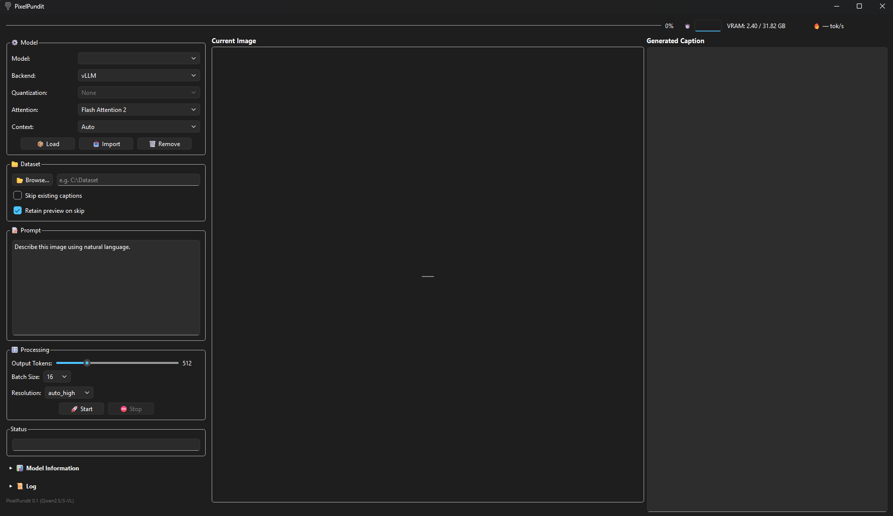

# PxCaption (Windows 64-bit, Python 3.13, CUDA)
<BR>
A windows desktop GUI that captions images and video using Qwen2.5/3-VL models. Pluggable backends (vLLM / Transformers) with torch compile, quantization, attention and batching options for fast local inference.
<BR>
<BR>
<div align="center">
  
</div>

## Features

- Runs locally.<BR>
- Imported models are stored in a database for easy model management.<BR>
- Pluggable inference backends.<BR>
  - `vLLM` — A high-throughput backend for batched generation.<BR>
  - `Transformers` — Hugging Face Transformers backend (simple, flexible quantization).<BR>
- Model & runtime options.<BR>
  - Choose model, quantization, and attention implementation per session.<BR>
  - Configurable batch sizes and token limits with context auto-sizing.<BR>
  - Model reuse / hot-swap to avoid unnecessary reloads.<BR>


## Requirements

- 64‑bit Windows, Python 3.13, NVIDIA GPU with CUDA support.

## Installation

1. **Clone the repository**:

   ```bash
   git clone https://github.com/Highstate/PxCaption.git PxCaption
   cd PxCaption

2. **Run the installer**

   ```bash
   Install.bat

3. **Run PxCaption**

   ```bash
   PixelPundit.bat

## Stack

- Python 3.13, Cuda 13.0, PyTorch 2.14.0, Triton-Windows 3.8.0.post29, vLLM 0.33.0, Flash Attention 2.8.3, PyQt6
